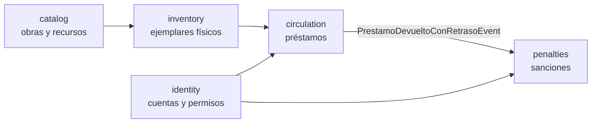

<div align="center">

# Biblioteca UNSA

### Sistema de préstamos académicos con arquitectura DDD

**Documentación ejecutiva, técnica y académica**


</div>

> [!NOTE]
> **Estado actual del repositorio.** El núcleo DDD, la API REST, la persistencia
> PostgreSQL/JPA/Flyway y el frontend React + TypeScript + Vite están implementados.
> La suite suma **58 tests verdes**: los **57 tests originales** más
> `JpaPersistenciaTest`. La autenticación JWT, los roles reales y las reservas quedan
> fuera de esta entrega.

Este repositorio reescribe el proyecto `TI_sis_prestamos` con **Domain-Driven Design (DDD)**
y cinco contextos delimitados. El objetivo no es acumular pantallas o endpoints, sino
construir un sistema cuyas reglas de negocio sean explícitas, testeables y defendibles en
una sustentación académica.

El estado anterior se conserva en el tag **`legacy-v0`** y en `docs/legacy/` como
referencia histórica. No se intentó reparar porque no compilaba y tenía dos fuentes de
verdad para el inventario.

---

## 1. Visión general

El sistema permite administrar el ciclo completo de una biblioteca universitaria:

- Registrar libros, equipos y otros recursos.
- Gestionar ejemplares físicos y su disponibilidad.
- Registrar cuentas, validarlas, suspenderlas y otorgar permisos.
- Prestar, devolver y renovar ejemplares.
- Generar sanciones automáticas por devoluciones tardías.
- Consultar el catálogo desde una interfaz web integrada.

### ¿Por qué DDD?

DDD no es una capa adicional ni una moda: es una forma de **proteger las reglas del
negocio** frente al cambio. Cada contexto delimitado tiene su propio lenguaje, sus propias
invariantes y sus propios límites. Esto produce cuatro beneficios concretos:

| Beneficio | Cómo se refleja en el proyecto |
|---|---|
| **Mantenibilidad** | Cambiar la persistencia no obliga a tocar las reglas de préstamo. |
| **Testabilidad** | El dominio se prueba sin Spring, sin base de datos y sin HTTP. |
| **Escalabilidad** | Cada contexto puede evolucionar o desplegarse por separado. |
| **Claridad académica** | Las decisiones se explican con un lenguaje ubicuo y un modelo explícito. |

> [!TIP]
> La idea central es sencilla: **el catálogo describe la obra; el inventario describe la
> unidad física prestable; circulación aplica las reglas del préstamo; identidad controla
> quién puede operar; y sanciones reacciona a los eventos de devolución tardía.**

### Los cinco contextos delimitados

| Contexto | Responsabilidad | Ejemplos |
|---|---|---|
| `catalog` | Describe obras y recursos | Libro, equipo, otro recurso |
| `inventory` | Gestiona unidades físicas | Ejemplar, código de barras, ubicación |
| `identity` | Gestiona cuentas y permisos | Alumno, docente, administrativo |
| `circulation` | Aplica reglas de préstamo | Préstamo, devolución, renovación |
| `penalties` | Gestiona sanciones | Retraso, daño, pérdida |

Los contextos comparten **identificadores tipados** y **eventos de dominio**, no agregados.
Las consultas cruzadas se hacen mediante puertos de lectura explícitos; por ejemplo,
`circulation` consulta `SancionRepository.existeActivaPara` sin modificar el agregado
`Sancion`. Esa frontera es la que permite que `circulation` no conozca los detalles
internos de `penalties`.

---

## 2. Estado del proyecto

| Área | Estado | Evidencia |
|---|---|---|
| Dominio puro en Java 21 | ✅ Completado | Agregados, value objects, eventos e invariantes |
| API REST `/api/v1` | ✅ Completado | Controladores, validación y `ProblemDetail` |
| Persistencia PostgreSQL/JPA | ✅ Completado | Adaptadores JPA, Flyway y esquema `V1__schema.sql` |
| Frontend React + TypeScript | ✅ Completado | Catálogo público, login demo y operaciones |
| Tests automatizados | ✅ 58 verdes | Dominio, aplicación, flujo, JPA y ArchUnit |
| Autenticación JWT y roles | ⏳ Pendiente | Fase de seguridad |
| Reservas | ⏳ Fuera de alcance | Ver [ADR-008](docs/adr/ADR-008-reservas-fuera-de-alcance.md) |

> [!IMPORTANT]
> **El login del frontend es una demostración.** No valida credenciales ni protege la API;
> los `operadorId` todavía se envían en el cuerpo de la petición. La autenticación real se
> implementará en la siguiente fase. No uses credenciales reales.

---

## 3. Stack tecnológico

| Capa | Tecnología |
|---|---|
| Lenguaje | Java 21 |
| Framework | Spring Boot 3.2.0 — Web, Validation, Actuator, Data JPA |
| Build | Maven Wrapper (`./mvnw` / `mvnw.cmd`) |
| Persistencia | PostgreSQL 16, Spring Data JPA, Flyway |
| Tests | JUnit 5, AssertJ, ArchUnit, Spring Boot Test, H2 |
| Frontend | React 18, TypeScript 5, Vite 5 |
| Documentación | Markdown, Mermaid, ADRs |

No se usa Lombok ni MapStruct. JPA vive únicamente en
`infrastructure/persistence/jpa`; el dominio no importa Spring, Jakarta Persistence,
Hibernate ni Jackson. **ArchUnit verifica esa pureza en cada build.**

---

## 4. Puesta en marcha

### 4.1 Requisitos

| Herramienta | Versión | Uso |
|---|---|---|
| JDK | 21 | Backend |
| Maven | 3.9+ o wrapper incluido | Compilación y tests |
| Docker + Compose | Actual | PostgreSQL y Adminer |
| Node.js | 18+ | Frontend |
| pnpm / npm | pnpm recomendado | Dependencias del frontend |

### 4.2 Inicio rápido

```bash
# 1. Base de datos
docker compose up -d

# 2. Backend (Linux / macOS)
cd backend
./mvnw spring-boot:run

# 3. Frontend (otra terminal)
cd frontend
pnpm install
pnpm dev
```

Abre:

- Frontend: <http://localhost:5173>
- API: <http://localhost:8080/api/v1>
- Health: <http://localhost:8080/actuator/health>
- Adminer: <http://localhost:8081>

> [!TIP]
> El catálogo puede consultarse sin sesión con **Ver catálogo público**. Para registrar
> préstamos o devoluciones, usa el login demo; cualquier correo y contraseña permiten
> continuar.

### 4.3 Comandos por sistema operativo

| Acción | Linux / macOS | Windows PowerShell | Windows CMD |
|---|---|---|---|
| Compilar | `./mvnw clean compile` | `mvn clean compile` | `mvn clean compile` |
| Ejecutar tests | `./mvnw test` | `mvn test` | `mvn test` |
| Levantar API | `./mvnw spring-boot:run` | `mvn spring-boot:run` | `mvn spring-boot:run` |
| Ver versión | `./mvnw -v` | `mvn -v` | `mvn -v` |
| Alternativa sin Maven | `./mvnw ...` | `.\mvnw.cmd ...` | `mvnw.cmd ...` |

> [!NOTE]
> Los comandos de Windows usan `mvn` cuando Maven está instalado globalmente. Si no lo
> está, el repositorio incluye el wrapper: `.\mvnw.cmd clean compile`, `.\mvnw.cmd test`
> y `.\mvnw.cmd spring-boot:run`.

#### Configurar Java 21

**Linux**

```bash
export JAVA_HOME=/ruta/a/jdk-21
export PATH="$JAVA_HOME/bin:$PATH"
java -version
```

**macOS**

```bash
export JAVA_HOME=$(/usr/libexec/java_home -v 21)
export PATH="$JAVA_HOME/bin:$PATH"
java -version
```

**Windows PowerShell**

```powershell
$env:JAVA_HOME = "C:\ruta\a\jdk-21"
$env:Path = "$env:JAVA_HOME\bin;$env:Path"
java -version
```

**Windows CMD**

```bat
set "JAVA_HOME=C:\ruta\a\jdk-21"
set "PATH=%JAVA_HOME%\bin;%PATH%"
java -version
```

### 4.4 PostgreSQL con Docker

```bash
docker compose up -d
docker compose ps
```

| Servicio | Puerto | Credenciales |
|---|---:|---|
| PostgreSQL | `5432` | base/usuario/clave: `biblioteca` |
| Adminer | `8081` | Gestión visual de la base |

Para detener los servicios:

```bash
docker compose down
```

Para borrar también los datos y volver al escenario inicial:

```bash
docker compose down -v
docker compose up -d
```

### 4.5 Backend

**Linux / macOS**

```bash
cd backend
./mvnw clean compile
./mvnw test
./mvnw spring-boot:run
```

**Windows PowerShell / CMD**

```powershell
cd backend
mvn clean compile
mvn test
mvn spring-boot:run
```

Alternativa con wrapper:

```powershell
.\mvnw.cmd clean compile
.\mvnw.cmd test
.\mvnw.cmd spring-boot:run
```

- Perfil por defecto: `demo`.
- Flyway aplica `V1__schema.sql` automáticamente.
- Para arrancar sin datos demo, agrega `-Dspring-boot.run.profiles=prod` al comando de
  arranque: `./mvnw spring-boot:run -Dspring-boot.run.profiles=prod` en Linux/macOS o
  `mvn spring-boot:run -Dspring-boot.run.profiles=prod` en Windows.
- La conexión se puede sobreescribir con `DB_URL`, `DB_USER` y `DB_PASSWORD`.

> [!NOTE]
> Los tests no necesitan Docker: usan H2 en modo PostgreSQL y ejecutan la misma migración
> Flyway. La validación contra PostgreSQL real es parte de la fase de operación.

### 4.6 Frontend

```bash
cd frontend
pnpm install
pnpm dev
```

Alternativa con npm:

```bash
npm install
npm run dev
```

Configuración en `frontend/.env`:

```env
VITE_API_BASE_URL=http://localhost:8080/api/v1
```

`.env` está ignorado por Git. Usa `.env.example` como plantilla. Si cambias el puerto del
backend, actualiza también el origen permitido en `WebConfig`.

---

## 5. Datos demo con UUIDs fijos

El perfil `demo` carga el siguiente escenario. El seed solo se ejecuta si la tabla
`usuarios` está vacía.

| Recurso | UUID | Notas |
|---|---|---|
| Bibliotecario (Elena) | `00000000-0000-0000-0000-000000000001` | `VALIDADO`, todos los permisos |
| Ana (alumna) | `00000000-0000-0000-0000-000000000002` | `PROVISIONAL`, no puede prestar ni operar |
| Luis (alumno) | `00000000-0000-0000-0000-000000000003` | `VALIDADO`, préstamo vencido |
| Rosa (docente) | `00000000-0000-0000-0000-000000000004` | `VALIDADO`, puede llevar equipos a domicilio |
| Libro *Clean Code* | `00000000-0000-0000-0000-000000000101` | ISBN `9780132350884` |
| Laptop Lenovo T14 | `00000000-0000-0000-0000-000000000102` | Equipo |
| Ejemplar `LIB-001` | `00000000-0000-0000-0000-000000000201` | Disponible |
| Ejemplar `LIB-002` | `00000000-0000-0000-0000-000000000202` | Prestado a Luis, vencido |
| Ejemplar `LAP-001` | `00000000-0000-0000-0000-000000000203` | Disponible |
| Préstamo vencido | `00000000-0000-0000-0000-000000000301` | Vence 3 días antes de “hoy” |

> [!IMPORTANT]
> El seed solo se ejecuta con el perfil `demo` y si la base no tiene usuarios. Los datos
> persisten entre reinicios; para reiniciar el escenario debes borrar el volumen con
> `docker compose down -v`.

---

## 6. API principal

Base: `http://localhost:8080/api/v1`

### Catálogo

| Método | Ruta | Descripción |
|---|---|---|
| `GET` | `/catalogo?q=&tipo=` | Lista o busca ítems |
| `GET` | `/catalogo/{id}` | Obtiene un ítem |
| `POST` | `/catalogo/libros` | Registra un libro |
| `POST` | `/catalogo/equipos` | Registra un equipo |
| `POST` | `/catalogo/otros` | Registra otro recurso |
| `POST` | `/catalogo/{id}/desactivar` | Saca un ítem de circulación |

### Inventario

| Método | Ruta | Descripción |
|---|---|---|
| `GET` | `/inventario/ejemplares?catalogoItemId=&barcode=` | Lista ejemplares |
| `GET` | `/inventario/ejemplares/{id}` | Obtiene un ejemplar |
| `POST` | `/inventario/ejemplares` | Registra una unidad física |
| `POST` | `/inventario/ejemplares/{id}/baja` | Da de baja un ejemplar |

### Identidad

| Método | Ruta | Descripción |
|---|---|---|
| `GET` | `/usuarios?q=&estado=&perfil=` | Lista o busca cuentas |
| `GET` | `/usuarios/{id}` | Obtiene una cuenta |
| `POST` | `/usuarios` | Registra una cuenta `PROVISIONAL` |
| `POST` | `/usuarios/{id}/validar` | Valida la cuenta |
| `POST` | `/usuarios/{id}/suspender` | Suspende con motivo |
| `POST` | `/usuarios/{id}/reactivar` | Reactiva la cuenta |
| `POST` | `/usuarios/{id}/permisos` | Otorga permiso operativo |
| `DELETE` | `/usuarios/{id}/permisos/{permiso}?operadorId=` | Revoca permiso |

### Circulación y sanciones

| Método | Ruta | Descripción |
|---|---|---|
| `GET` | `/prestamos?prestatarioId=&estado=` | Lista préstamos |
| `GET` | `/prestamos/{id}` | Obtiene un préstamo |
| `POST` | `/prestamos` | Registra un préstamo |
| `POST` | `/prestamos/{id}/devolucion` | Registra devolución |
| `POST` | `/prestamos/{id}/renovacion` | Renueva si no está vencido |
| `GET` | `/sanciones?usuarioId=&estado=` | Lista sanciones |
| `POST` | `/sanciones` | Registra sanción manual |
| `POST` | `/sanciones/{id}/cumplir` | Marca la sanción como cumplida |

Los errores usan `application/problem+json` (`ProblemDetail`) e incluyen un campo `codigo`
estable para el frontend, por ejemplo `SANCION_ACTIVA`, `USUARIO_NO_HABILITADO` o
`AUTOPRESTAMO_NO_PERMITIDO`.

> [!TIP]
> La demo completa con `curl`, incluidos los errores esperados, está en
> [`docs/demo.md`](docs/demo.md).

---

## 7. Roles, permisos y reglas de negocio

### 7.1 Perfiles y alcance

| Perfil | Consulta catálogo | Solicita préstamos | Opera ventanilla | Límite simultáneo | Renovaciones |
|---|---|---:|---:|---:|---:|
| `ALUMNO` | ✅ | ✅ si está `VALIDADO` | ❌ | 3 | 1 |
| `DOCENTE` | ✅ | ✅ si está `VALIDADO` | ❌ | 10 | 2 |
| `ADMINISTRATIVO` | ✅ | ✅ si está `VALIDADO` | Solo con permiso | 5 | 2 |

Los permisos operativos son explícitos: `REGISTRAR_PRESTAMO`,
`VALIDAR_USUARIO_PROVISIONAL`, `GESTIONAR_CATALOGO` y `GESTIONAR_SANCIONES`. No son roles
y no saltan la validación de la cuenta.

### 7.2 Identidad

- `PROVISIONAL` puede consultar el catálogo, pero **no** solicitar préstamos ni operar.
- Un permiso operativo no salta la regla anterior: primero hay que validar la cuenta.
- Transiciones permitidas: `PROVISIONAL → VALIDADO → SUSPENDIDO → VALIDADO`.
- La suspensión exige motivo.
- Solo una cuenta `VALIDADO` puede recibir permisos operativos.

### 7.3 Circulación

- El prestatario debe existir y estar `VALIDADO`.
- El operador debe estar `VALIDADO` y tener `REGISTRAR_PRESTAMO`.
- `operadorId != prestatarioId`: no hay autopréstamo.
- El ítem debe estar activo y el ejemplar disponible.
- No puede haber dos préstamos activos sobre el mismo ejemplar.
- No se presta con sanción activa ni con préstamo vencido pendiente.
- Se respeta el máximo de préstamos simultáneos por perfil.
- Los equipos solo salen a domicilio para docentes y administrativos.
- Un préstamo vencido puede devolverse, pero no renovarse.
- “Vencido” se deriva de las fechas; no se persiste como estado.

### 7.4 Sanciones

- Una devolución tardía publica `PrestamoDevueltoConRetrasoEvent`.
- `penalties` reacciona y crea una `Sancion`: 1 día de suspensión y S/ 1.00 por día de
  retraso, con tope de 30 días.
- Una sanción activa bloquea nuevos préstamos.
- La sanción puede cumplirse o anularse; no cambia el estado de la cuenta.

### 7.5 Política de plazos

| Perfil | Libro | Equipo | Otro | Máx. simultáneos | Renovaciones |
|---|---:|---:|---:|---:|---:|
| Alumno | 7 días | 1 día | 3 días | 3 | 1 |
| Docente | 30 días | 7 días | 7 días | 10 | 2 |
| Administrativo | 15 días | 3 días | 5 días | 5 | 2 |

---

## 8. Arquitectura en una vista



La regla de dependencias es estricta:

```text
infrastructure/web ─┐
infrastructure/jpa ─┼──> application ──> domain
infrastructure/events┘
```

- `domain` no conoce Spring, JPA, Hibernate, Jackson ni `infrastructure`.
- Los repositorios son **puertos** definidos en `domain/repository`.
- Los adaptadores JPA e in-memory implementan esos puertos en infraestructura.
- Los eventos desacoplan la **creación** de sanciones: `circulation` publica y `penalties`
  reacciona. Para bloquear préstamos, `circulation` consulta el puerto de lectura
  `SancionRepository.existeActivaPara`.
- `ArquitecturaTest` verifica estas reglas en cada build.

### Estructura del repositorio

```text
TI_sis_prestamos/
├── backend/
│   ├── pom.xml
│   └── src/
│       ├── main/java/com/biblioteca/
│       │   ├── shared/domain/              # AggregateRoot, ValueObject, DomainEvent
│       │   ├── shared/application/         # DomainEventPublisher
│       │   ├── catalog/                    # Catálogo e ítems
│       │   ├── inventory/                  # Ejemplares físicos
│       │   ├── identity/                   # Cuentas y permisos
│       │   ├── circulation/                # Préstamos y devoluciones
│       │   ├── penalties/                  # Sanciones y multas
│       │   └── infrastructure/
│       │       ├── persistence/jpa/        # Entidades y adaptadores JPA
│       │       ├── persistence/inmemory/   # Adaptadores para tests
│       │       ├── config/                 # Spring, CORS y datos demo
│       │       └── web/                    # Controladores y ProblemDetail
│       ├── main/resources/
│       │   ├── application.yml             # PostgreSQL/JPA/Flyway
│       │   └── db/migration/V1__schema.sql
│       └── test/java/com/biblioteca/       # 58 tests + ArchUnit
├── docs/
│   ├── arquitectura.md
│   ├── demo.md
│   ├── adr/
│   └── legacy/
├── frontend/                               # React + TypeScript + Vite
├── docker-compose.yml                      # PostgreSQL 16 + Adminer
└── AGENT.md                                # Guía para agentes y desarrolladores
```

Cada contexto de negocio sigue la misma forma:

```text
<contexto>/
├── domain/
│   ├── model/          # Agregados, entidades, enums
│   ├── event/          # Eventos de dominio
│   ├── policy/         # Reglas configurables
│   ├── repository/     # Puertos de salida
│   └── vo/             # IDs tipados y value objects
└── application/
    ├── command/        # Intenciones de escritura
    └── usecase/        # Orquestación sin reglas de negocio
```

El detalle completo, los diagramas de secuencia y las decisiones por contexto están en
[`docs/arquitectura.md`](docs/arquitectura.md).

---

## 9. Pruebas

La suite se ejecuta con:

```bash
cd backend
./mvnw test
```

Resultado esperado:

```text
BUILD SUCCESS
Tests run: 58, Failures: 0, Errors: 0, Skipped: 0
```

### Composición de la suite

| Suite | Tests | Qué protege |
|---|---:|---|
| `UsuarioTest` | 9 | Estados, permisos e invariantes de cuenta |
| `ISBNTest` | 5 | Normalización y checksum ISBN |
| `ContextLoadsTest` | 1 | Contexto Spring, JPA, Flyway y H2 |
| `JpaPersistenciaTest` | 1 | Persistencia de los cinco agregados |
| `SancionTest` | 6 | Vigencia, multa y estados de sanción |
| `PrestamoDevueltoConRetrasoListenerTest` | 1 | Evento → sanción automática |
| `FlujoPrestamoTest` | 1 | Flujo completo sin Spring |
| `EjemplarTest` | 8 | Disponibilidad y transiciones físicas |
| `PrestamoTest` | 9 | Invariantes y devolución tardía |
| `RegistrarPrestamoUseCaseTest` | 10 | Reglas compuestas de préstamo |
| `RegistrarDevolucionUseCaseTest` | 4 | Devolución y eventos |
| `ArquitecturaTest` | 3 | Pureza del dominio y dependencias |

> [!NOTE]
> Los **57 tests originales** de dominio, aplicación, flujo y arquitectura se conservan.
> `JpaPersistenciaTest` añade el test 58. Los tests de persistencia usan H2 en modo
> PostgreSQL y la misma migración Flyway; no requieren Docker.

---

## 10. Roadmap de cuatro fases

| Fase | Alcance | Estado |
|---|---|---|
| **1. Núcleo DDD + API + persistencia** | Contextos, reglas, REST, PostgreSQL, JPA, Flyway, tests y demo | ✅ Completada |
| **2. Frontend integrado** | React + TypeScript + Vite, cliente HTTP, `ProblemDetail`, operaciones | ✅ Implementada y commiteada en `main` (`8f03528`) |
| **3. Seguridad** | JWT, roles, sesiones reales y operador derivado del token | ⏳ Futura |
| **4. Operación y calidad** | Testcontainers, outbox, CI/CD, observabilidad, backups | ⏳ Futura |

> [!IMPORTANT]
> El repositorio ya incluye el avance de la Fase 2 (persistencia y frontend). El roadmap
> se mantiene en cuatro fases para la exposición; la columna **Estado** refleja el avance
> real del repositorio y evita presentar como futuro lo que ya está implementado.

**Alcance confirmado para la siguiente fase:** login solo para personal bibliotecario y
administradores; catálogo público para alumnos; `identity` se mantiene unificado y
preparado para habilitar el acceso de alumnos sin cambios de esquema. Las reservas quedan
fuera del alcance principal.

### Pendientes conocidos

- No hay autenticación real: el login del frontend es demo y los `operadorId` se confían.
- Los eventos se entregan de forma síncrona; falta outbox/async y Testcontainers.
- Los endpoints de catálogo e inventario aún no exigen `GESTIONAR_CATALOGO`.
- No hay reservas, paginación, bloqueo optimista ni auditoría persistente.
- La regla “un préstamo activo por ejemplar” se aplica en el caso de uso, pero aún no tiene
  índice único parcial en PostgreSQL.

---

## 11. Documentación

| Documento | Contenido |
|---|---|
| [Arquitectura](docs/arquitectura.md) | Contextos, dependencias, eventos, persistencia y trade-offs |
| [Demo con curl](docs/demo.md) | Recorrido reproducible con resultados esperados |
| [ADRs](docs/adr/) | Decisiones de arquitectura y su justificación |
| [Guía para agentes](AGENT.md) | Reglas duras, comandos y mapa del código |
| [Frontend](frontend/README.md) | Configuración, scripts y estructura de la interfaz |
| [Legacy](docs/legacy/) | Referencia histórica, no forma parte del build |

---

## 12. Valor académico del diseño

Este proyecto prioriza tres cosas que suelen perderse en trabajos de curso:

1. **Reglas explícitas.** Las validaciones no están dispersas en controladores; viven en
   agregados y políticas.
2. **Fronteras defendibles.** Cada contexto tiene una responsabilidad clara y un lenguaje
   propio. Se puede explicar por qué `catalog` no presta y por qué `inventory` no decide
   sanciones.
3. **Evidencia verificable.** Los tests, ArchUnit, Flyway y la demo reproducible permiten
   demostrar que el diseño funciona, no solo describirlo.

> [!NOTE]
> Proyecto de Ingeniería de Software — Universidad Nacional de San Agustín. La reescritura
> busca que las reglas del negocio sean explícitas, testeables y defendibles en una
> sustentación, por encima de acumular endpoints o pantallas sin coherencia.
