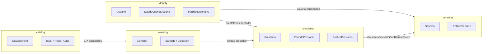
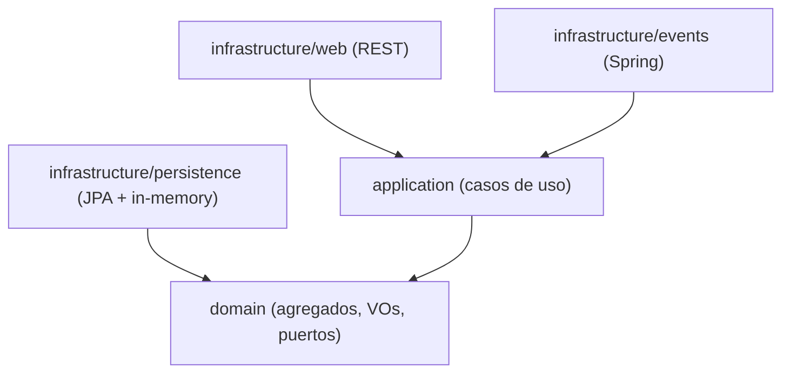
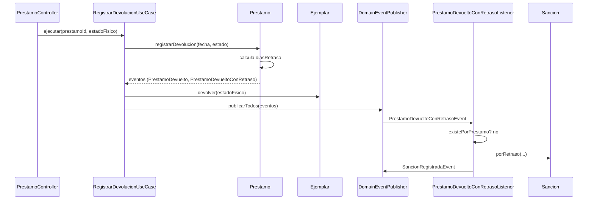

<div align="center">

# Arquitectura del sistema

### Biblioteca UNSA — Documento técnico y académico


**Referencia de diseño, límites, dependencias y decisiones**

</div>

> [!NOTE]
> Este documento explica **por qué** el sistema está dividido en cinco contextos
> delimitados, **cómo** se relacionan y **qué reglas** protege cada uno. Las decisiones
> puntuales se registran en [`adr/`](adr/); la guía operativa está en
> [`../README.md`](../README.md) y la demo en [`demo.md`](demo.md).

---

## 1. Resumen ejecutivo

El sistema se organiza con **Domain-Driven Design (DDD)** y arquitectura hexagonal. La
idea central es que el negocio no dependa de Spring, de la base de datos ni de la interfaz
web. El dominio contiene los agregados, value objects, políticas y eventos; la aplicación
orquesta casos de uso; la infraestructura implementa los puertos.

Esta separación produce beneficios concretos:

| Objetivo | Mecanismo | Resultado |
|---|---|---|
| Mantener las reglas estables | Agregados y políticas sin framework | Cambios de infraestructura no rompen el negocio |
| Probar rápido | Tests de dominio sin Spring ni base de datos | Feedback inmediato y determinista |
| Evitar acoplamiento | Puertos en dominio, adaptadores en infraestructura | JPA puede sustituirse por otro mecanismo |
| Escalar por equipos | Cinco contextos delimitados | Cada contexto evoluciona con autonomía |
| Explicar el sistema | Lenguaje ubicuo y eventos explícitos | Decisiones defendibles en una sustentación |

> [!IMPORTANT]
> **El dominio manda.** Un controlador no decide si un préstamo es válido; un repositorio
> no contiene reglas; una entidad JPA no es un agregado. Esa disciplina es el núcleo del
> diseño y está verificada por ArchUnit.

---

## 2. Principios de diseño

| Principio | Aplicación en el proyecto |
|---|---|
| **Dominio sin framework** | `com.biblioteca.*.domain` no importa Spring, JPA, Hibernate, Jackson ni `infrastructure`. |
| **Dependencias hacia adentro** | Infraestructura → aplicación → dominio. El dominio no conoce capas superiores. |
| **Puertos en el dominio** | Los repositorios son interfaces en `domain/repository/`. |
| **Una fuente de verdad** | No hay contadores de stock; la disponibilidad se deriva del ejemplar y del préstamo activo. |
| **Eventos para desacoplar** | `circulation` publica eventos; `penalties` reacciona sin acoplarse a su modelo de escritura. |
| **Fallar con códigos estables** | Las reglas lanzan `BusinessRuleException` con `codigo` para el frontend. |
| **Tests como contrato** | Dominio, aplicación, persistencia y arquitectura tienen pruebas automatizadas. |

### ¿Por qué cinco contextos?

Cada contexto delimita un **lenguaje** y un **modelo**. Por ejemplo, “libro” en `catalog`
es una obra bibliográfica; en `inventory` la unidad prestable es un `Ejemplar` con código
de barras. Mezclar ambos conceptos fue uno de los problemas del sistema legacy.

| Contexto | Pregunta que responde | No debería encargarse de |
|---|---|---|
| `catalog` | ¿Qué recursos existen? | Stock, préstamos o sanciones |
| `inventory` | ¿Qué unidades físicas hay y en qué estado? | Reglas de préstamo |
| `identity` | ¿Quién puede consultar, solicitar u operar? | Disponibilidad de ejemplares |
| `circulation` | ¿Se puede prestar, devolver o renovar? | Multas o datos bibliográficos |
| `penalties` | ¿Qué sanción corresponde y está vigente? | Préstamos o cuentas |

---

## 3. Mapa de contextos



Los contextos comparten **identificadores tipados** y **eventos de dominio**. No comparten
agregados. Las consultas cruzadas se hacen mediante puertos de lectura explícitos; por
ejemplo, `circulation` usa `SancionRepository.existeActivaPara` sin modificar el agregado
`Sancion`. Las referencias entre contextos se guardan como UUID y se refuerzan con claves
foráneas en la base de datos, pero no se modelan como relaciones JPA entre agregados.

---

## 4. Regla de dependencias



`domain` no apunta a ninguna capa superior: las flechas solo entran.

Reglas ejecutables en `ArquitecturaTest`:

- `..domain..` no depende de Spring, Jakarta Persistence, Hibernate, Jackson ni
  `..infrastructure..`.
- `..domain.repository..` contiene solo interfaces.
- `..application..` no depende de `..infrastructure..`.

> [!TIP]
> Si una regla de negocio parece necesitar un `@Service` o una anotación JPA, la respuesta
> correcta suele ser mover la decisión al agregado o crear un puerto. ArchUnit está para
> detectar la excepción antes de que se convierta en deuda técnica.

---

## 5. Shared kernel

Paquete `com.biblioteca.shared`:

| Elemento | Rol |
|---|---|
| `AggregateRoot<ID>` | Identidad, lista de eventos y `extraerEventos()` |
| `ValueObject` | Marcador para objetos inmutables |
| `DomainEvent` | Contrato de evento (`occurredOn()`, `eventName()`) |
| `DomainException` | Error de dominio con `codigo` estable |
| `BusinessRuleException` | Regla de negocio violada (HTTP 409) |
| `NotFoundException` | Recurso inexistente (HTTP 404) |
| `DomainEventPublisher` | Puerto de salida para publicar eventos |

No hay utilidades genéricas innecesarias ni un “service” global. Cada contexto tiene su
propio modelo y su propio lenguaje.

---

## 6. Contextos delimitados

### 6.1 `catalog` — catálogo de recursos

**Responsabilidad:** describir la obra o recurso, no su disponibilidad física.

| Elemento | Detalle |
|---|---|
| Agregado | `CatalogoItem` |
| Identidad | `CatalogoItemId` (UUID) |
| Atributos | `Titulo`, `TipoItem`, `DetalleItem`, `activo`, `fechaAlta` |
| Tipos | `LIBRO`, `EQUIPO`, `OTRO` |
| Puerto | `CatalogoItemRepository` |
| Value objects | `ISBN`, `Titulo`, `Autor` |

`DetalleItem` es una interfaz sellada con tres implementaciones:

```text
LibroDetalle(ISBN, Autor, editorial, anioPublicacion)
EquipoDetalle(marca, modelo)
OtroDetalle(descripcion)
```

**Decisión clave:** no existe `stockTotal`, `stockDisponible` ni contadores equivalentes.
Un ítem de catálogo es la *obra*; los ejemplares físicos viven en `inventory`. La
disponibilidad se calcula con `Ejemplar.estaDisponible()` y la ausencia de un préstamo
activo.

**Puerto:** `CatalogoItemRepository` (`guardar`, `buscarPorId`, `listarTodos`,
`existePorIsbn`).

**Casos de uso:** registrar libro, equipo u otro recurso; listar; obtener; desactivar.

> [!NOTE]
> `ISBN` valida checksum ISBN-10/13 y normaliza el valor. El catálogo no sabe si una obra
> tiene ejemplares disponibles: esa pregunta pertenece a `inventory` y `circulation`.

---

### 6.2 `inventory` — ejemplares físicos

**Responsabilidad:** representar cada unidad prestable y su estado físico.

| Elemento | Detalle |
|---|---|
| Agregado | `Ejemplar` |
| Identidad | `EjemplarId` (UUID) |
| Atributos | `catalogoItemId`, `Barcode`, `Ubicacion`, `EstadoFisico`, `notas`, `fechaAlta` |
| Estados | `DISPONIBLE`, `PRESTADO`, `DANADO`, `PERDIDO`, `BAJA` |
| Puerto | `EjemplarRepository` |
| Value objects | `Barcode`, `Ubicacion`, `EjemplarId` |

**Transiciones principales:**

```text
DISPONIBLE --prestar--> PRESTADO
PRESTADO --devolver--> DISPONIBLE | DANADO | PERDIDO
DISPONIBLE | DANADO | PERDIDO --baja--> BAJA
```

`Barcode` normaliza a mayúsculas y valida el formato. La baja solo se permite si el
ejemplar no está prestado.

**Puerto:** `EjemplarRepository` (`guardar`, `buscarPorId`, `buscarPorBarcode`,
`listarTodos`, `listarPorItem`, `existePorBarcode`).

**Casos de uso:** registrar ejemplar, listar, obtener por ID o barcode, dar de baja.

> [!IMPORTANT]
> La disponibilidad no vive en el catálogo. `catalog` describe la obra; `inventory`
> describe la unidad física; `circulation` decide si esa unidad puede prestarse.

---

### 6.3 `identity` — cuentas y permisos

**Responsabilidad:** determinar quién puede consultar, solicitar préstamos u operar
ventanilla.

| Elemento | Detalle |
|---|---|
| Agregado | `Usuario` |
| Identidad | `UsuarioId` (UUID) |
| Atributos | `EmailAddress`, `NombreCompleto`, `PerfilPrestatario`, `EstadoCuentaUsuario`, `permisos`, `fechaAlta`, `fechaValidacion`, `motivoSuspension` |
| Perfiles | `ALUMNO`, `DOCENTE`, `ADMINISTRATIVO` |
| Estados | `PROVISIONAL`, `VALIDADO`, `SUSPENDIDO` |
| Puerto | `UsuarioRepository` |

**Máquina de estados:**

```text
PROVISIONAL --validar--> VALIDADO --suspender--> SUSPENDIDO
                               ^                     |
                               +------reactivar------+
```

**Invariantes:**

- `PROVISIONAL` no tiene `fechaValidacion`.
- `VALIDADO` exige `fechaValidacion`.
- `SUSPENDIDO` exige `fechaValidacion` y `motivoSuspension`.
- Solo `VALIDADO` recibe permisos operativos.
- `puedeConsultarCatalogo()` siempre es `true`.
- `puedeSolicitarPrestamo()` y `puedeOperarVentanilla()` exigen `VALIDADO`; la segunda
  además el permiso `REGISTRAR_PRESTAMO`.

**Permisos operativos:**

| Permiso | Alcance |
|---|---|
| `REGISTRAR_PRESTAMO` | Operar ventanilla y registrar préstamos |
| `VALIDAR_USUARIO_PROVISIONAL` | Validar cuentas |
| `GESTIONAR_CATALOGO` | Administrar catálogo e inventario |
| `GESTIONAR_SANCIONES` | Registrar y cumplir sanciones |
| `GESTIONAR_USUARIOS` | Registrar, suspender, reactivar y administrar permisos de cuentas |

No son roles: se otorgan explícitamente y no saltan la validación de la cuenta.
Una cuenta `VALIDADO` con al menos un permiso de gestión expone el rol derivado
`rolAcceso = ADMINISTRADOR` (calculado en el dominio, única fuente de verdad).

**Puerto:** `UsuarioRepository` (`guardar`, `buscarPorId`, `buscarPorEmail`,
`listarTodos`, `existePorEmail`).

**Casos de uso:** registrar provisional, validar, suspender, reactivar, otorgar/revocar
permiso, listar, obtener.

---

### 6.4 `circulation` — préstamos y devoluciones

**Responsabilidad:** aplicar las reglas de circulación y mantener el ciclo de vida del
préstamo.

| Elemento | Detalle |
|---|---|
| Agregado | `Prestamo` |
| Identidad | `PrestamoId` (UUID) |
| Referencias | `operadorId`, `prestatarioId`, `ejemplarId` |
| Atributos | `PeriodoPrestamo`, `LugarUso`, `EstadoPrestamo`, `fechaDevolucion`, `renovaciones`, `observaciones`, `fechaAlta` |
| Estados | `ACTIVO`, `DEVUELTO`, `PERDIDO` |
| Puerto | `PrestamoRepository` |
| Política | `PoliticaPrestamo` / `PoliticaPrestamoEstandar` |

**Decisión clave:** “vencido” **no se persiste** como estado. Se deriva de
`PeriodoPrestamo.estaVencido(hoy)` y se expone como dato calculado. Esto evita estados
contradictorios y permite que la demo use fechas relativas.

**Invariante central:** `operadorId != prestatarioId`.

**Validaciones de `RegistrarPrestamoUseCase` en orden:**

1. El prestatario existe y está validado.
2. El operador existe, está validado y tiene `REGISTRAR_PRESTAMO`.
3. No hay autopréstamo.
4. El ítem está activo.
5. El ejemplar está disponible.
6. No hay otro préstamo activo sobre ese ejemplar.
7. El prestatario no tiene sanción activa.
8. El prestatario no tiene préstamo vencido pendiente.
9. No supera el máximo de préstamos simultáneos.
10. La política permite el lugar de uso (domicilio para equipos).
11. Calcula el período y registra el préstamo + eventos.

**Puerto:** `PrestamoRepository` (`guardar`, `buscarPorId`, `listarTodos`,
`listarPorPrestatario`, `existeActivoPara`, `contarActivosPor`, `tieneVencido`).

**Casos de uso:** registrar préstamo, devolución, renovación, listar, obtener.

> [!NOTE]
> La regla “un préstamo activo por ejemplar” se aplica en el caso de uso mediante
> `PrestamoRepository.existeActivoPara`. El índice único parcial en PostgreSQL queda como
> mejora de concurrencia para una fase posterior.

---

### 6.5 `penalties` — sanciones y multas

**Responsabilidad:** calcular, registrar y controlar la vigencia de las sanciones.

| Elemento | Detalle |
|---|---|
| Agregado | `Sancion` |
| Identidad | `SancionId` (UUID) |
| Referencias | `usuarioId`, `prestamoId` opcional |
| Atributos | `MotivoSancion`, `diasSuspension`, `MontoMulta`, `fechaInicio`, `fechaFin`, `EstadoSancion`, `observaciones` |
| Motivos | `RETRASO`, `DANO`, `PERDIDA` |
| Estados | `ACTIVA`, `CUMPLIDA`, `ANULADA` |
| Puerto | `SancionRepository` |
| Política | `PoliticaSancionEstandar` |

**Vigencia:** una sanción está vigente desde `fechaInicio` (inclusive) hasta `fechaFin`
(exclusiva). Una suspensión de 1 día iniciada hoy bloquea hoy y deja de bloquear mañana.

**Política estándar:** 1 día de suspensión y S/ 1.00 por día de retraso, con tope de 30
días.

**Puerto:** `SancionRepository` (`guardar`, `buscarPorId`, `listarTodas`,
`listarPorUsuario`, `existeActivaPara`, `existePorPrestamo`).

**Casos de uso:** listar, cumplir, registrar sanción manual.

**Listener:** `PrestamoDevueltoConRetrasoListener` escucha
`PrestamoDevueltoConRetrasoEvent`, verifica idempotencia por `prestamoId` y crea la
sanción. La creación está desacoplada: `circulation` no invoca `Sancion.porRetraso`. Para
bloquear nuevos préstamos, el caso de uso consulta únicamente el puerto de lectura
`SancionRepository.existeActivaPara`; no modifica el agregado `Sancion`.

---

## 7. Flujo de eventos

### 7.1 Devolución tardía → sanción automática



Hoy la entrega es síncrona, en el mismo hilo y transacción lógica. El puerto permite
cambiar a `@TransactionalEventListener` + outbox o a un broker sin tocar el dominio. La
idempotencia se apoya en `SancionRepository.existePorPrestamo`.

> [!TIP]
> La prueba `FlujoPrestamoTest` demuestra el recorrido completo sin Spring:
> préstamo → devolución tardía → evento → sanción → bloqueo. Es la evidencia más directa
> del valor del diseño basado en eventos.

### 7.2 Eventos publicados

| Contexto | Evento | Cuándo |
|---|---|---|
| `catalog` | `ItemCatalogoRegistradoEvent` | Al registrar un ítem |
| `inventory` | `EjemplarRegistradoEvent` | Al registrar un ejemplar |
| `inventory` | `EjemplarPrestadoEvent` | Al prestar |
| `inventory` | `EjemplarDevueltoEvent` | Al devolver |
| `identity` | `UsuarioProvisionalRegistradoEvent` | Al registrarse |
| `identity` | `UsuarioValidadoEvent` | Al validar |
| `identity` | `UsuarioSuspendidoEvent` | Al suspender |
| `identity` | `UsuarioReactivadoEvent` | Al reactivar |
| `identity` | `PermisoOtorgadoEvent` | Al otorgar permiso |
| `circulation` | `PrestamoRegistradoEvent` | Al crear préstamo |
| `circulation` | `PrestamoRenovadoEvent` | Al renovar |
| `circulation` | `PrestamoDevueltoEvent` | Al devolver |
| `circulation` | `PrestamoDevueltoConRetrasoEvent` | Si la devolución es tardía |
| `penalties` | `SancionRegistradaEvent` | Al crear sanción |
| `penalties` | `SancionCumplidaEvent` | Al cumplir |

---

## 8. Persistencia

La implementación por defecto usa **PostgreSQL 16 + Spring Data JPA + Flyway**. La
propiedad `biblioteca.persistence` selecciona el adaptador:

| Valor | Adaptador | Uso |
|---|---|---|
| `jpa` (por defecto) | `infrastructure/persistence/jpa/` | Producción y demo |
| `inmemory` | `infrastructure/persistence/inmemory/` | Tests unitarios y ejercicios sin base |

### 8.1 Esquema Flyway

`V1__schema.sql` crea las tablas de los cinco contextos:

| Contexto | Tabla | Notas |
|---|---|---|
| `identity` | `usuarios` | `email` único; permisos como lista CSV |
| `catalog` | `catalogo_items` | Columnas opcionales según el tipo de detalle |
| `inventory` | `ejemplares` | `barcode` único; FK al catálogo |
| `circulation` | `prestamos` | Fechas, estado y referencias por ID |
| `penalties` | `sanciones` | `prestamo_id` opcional; multa `NUMERIC(12,2)` |

Las referencias entre contextos se guardan como UUID y se refuerzan con claves foráneas.
No hay relaciones JPA entre agregados: el adaptador reconstruye cada agregado de forma
independiente.

### 8.2 Entidades y adaptadores

- Las entidades JPA viven en `infrastructure/persistence/jpa/entity/` y usan columnas
  primitivas, enums y UUID. **No son los agregados de dominio.**
- Los adaptadores en `infrastructure/persistence/jpa/adapter/` implementan los puertos del
  dominio y traducen entidad ↔ agregado.
- Los repositorios Spring Data están en `.../jpa/repository/`.
- Los value objects se reconstruyen con los constructores/`reconstruir` del dominio, por lo
  que las validaciones se siguen aplicando al leer de la base de datos.
- `Prestamo` persiste `estado` y fechas; “vencido” y `diasRetraso` se derivan al responder.
- La regla “un préstamo ACTIVO por ejemplar” se aplica en el caso de uso mediante el puerto
  `PrestamoRepository.existeActivoPara`. El índice único parcial de PostgreSQL queda como
  mejora de concurrencia pendiente.

### 8.3 Configuración y tests

| Elemento | Configuración |
|---|---|
| Base por defecto | `jdbc:postgresql://localhost:5432/biblioteca` |
| Variables de entorno | `DB_URL`, `DB_USER`, `DB_PASSWORD` |
| Esquema | Flyway, `classpath:db/migration` |
| Validación JPA | `ddl-auto=validate` |
| Tests | H2 en modo PostgreSQL, misma migración Flyway |
| Seed | Perfil `demo`, solo si la tabla `usuarios` está vacía |

- `JpaPersistenciaTest` guarda y reconstruye los cinco agregados.
- Los casos de uso que escriben están anotados con `@Transactional`; el listener de
  sanciones participa de la misma transacción.
- El `docker-compose.yml` de la raíz define PostgreSQL 16 y Adminer.

> [!NOTE]
> La validación con Testcontainers/PostgreSQL real y el outbox de eventos quedan para una
> fase posterior. Los tests actuales no dependen de Docker.

---

## 9. Estrategia de pruebas

| Nivel | Qué prueba | Dónde |
|---|---|---|
| Value objects | Normalización y validación | `catalog/domain/vo/ISBNTest` |
| Agregados | Invariantes y transiciones | `identity`, `inventory`, `circulation`, `penalties` |
| Aplicación | Orquestación y reglas compuestas | `*UseCaseTest` |
| Flujo | Préstamo → devolución tardía → sanción → bloqueo | `FlujoPrestamoTest` |
| Contexto | Beans, JPA, Flyway y esquema H2 | `ContextLoadsTest` |
| Persistencia | Guardar/reconstruir los cinco agregados con JPA | `JpaPersistenciaTest` |
| Arquitectura | Dependencias y pureza | `ArquitecturaTest` |

Las pruebas de aplicación usan dobles in-memory reales (los mismos adaptadores), no mocks
frágiles de repositorios. Las pruebas de persistencia usan H2 en modo PostgreSQL y la misma
migración Flyway; no requieren Docker. El foco está en el comportamiento observable.

> [!IMPORTANT]
> `ArquitecturaTest` es el guardián de las reglas de dependencia. Si falla, no se desactiva:
> se corrige la dependencia. `FlujoPrestamoTest` es la evidencia más valiosa para la
> sustentación porque demuestra el negocio completo sin infraestructura.

### Composición de la suite

| Suite | Tests |
|---|---:|
| `UsuarioTest` | 9 |
| `ISBNTest` | 5 |
| `ContextLoadsTest` | 1 |
| `JpaPersistenciaTest` | 1 |
| `SancionTest` | 6 |
| `PrestamoDevueltoConRetrasoListenerTest` | 1 |
| `FlujoPrestamoTest` | 1 |
| `EjemplarTest` | 8 |
| `PrestamoTest` | 9 |
| `RegistrarPrestamoUseCaseTest` | 10 |
| `RegistrarDevolucionUseCaseTest` | 4 |
| `ArquitecturaTest` | 3 |
| **Total** | **58** |

---

## 10. Correcciones respecto al legacy

| Problema legacy | Corrección |
|---|---|
| `Application` con nombre distinto al declarado | `BibliotecaApplication` coherente |
| Imports a `pe.edu.unsa.sisprestamos` inexistentes | Paquete único `com.biblioteca` |
| UUID en Java vs `BIGINT` en SQL | IDs UUID tipados en todo el sistema |
| `stockTotal` y `stockDisponible` duplicados | Sin contadores; disponibilidad derivada del ejemplar |
| Repositorio con `@EntityScan` roto | Puertos en dominio + adaptadores JPA/in-memory explícitos |
| Seeds contradictorios | `DemoDataConfig` con IDs fijos y un caso vencido reproducible |
| Sin restricción de préstamo activo único | Regla en caso de uso + índice único parcial planificado |
| `target/` versionado | `.gitignore` y build limpio |
| Sin tests ni documentación | 58 tests, ADRs, demo reproducible y frontend integrado |

---

## 11. Riesgos y trade-offs

| Riesgo | Impacto | Mitigación / siguiente paso |
|---|---|---|
| **Concurrencia** | Dos ventanillas podrían prestar el mismo ejemplar | Índice único parcial y bloqueo optimista |
| **Eventos síncronos** | Si falla el listener, falla la devolución | Outbox y reintentos |
| **Sin autenticación** | Cualquiera puede enviar un `operadorId` válido | JWT y operador derivado del token |
| **Políticas en código** | Cambiar plazos o multas requiere despliegue | Externalizar a configuración |
| **Catálogo sin permisos** | Endpoints de escritura abiertos | Exigir `GESTIONAR_CATALOGO` en seguridad |
| **Sin PostgreSQL real en CI** | Diferencias sutiles H2/PostgreSQL | Testcontainers en CI |

> [!WARNING]
> El sistema está en modo demostración. No debe exponerse a Internet ni usarse con datos
> reales hasta implementar autenticación, autorización y auditoría.

---

## 12. Glosario

| Término | Definición aplicada |
|---|---|
| **Contexto delimitado** | Frontera explícita alrededor de un modelo y un lenguaje. |
| **Agregado** | Grupo de objetos con una raíz y reglas de consistencia transaccional. |
| **Value object** | Objeto inmutable definido por sus valores, no por identidad. |
| **Puerto** | Interfaz del dominio que define lo que necesita del exterior. |
| **Adaptador** | Implementación de un puerto en infraestructura. |
| **Evento de dominio** | Hecho relevante del negocio que otros contextos pueden consumir. |
| **Lenguaje ubicuo** | Vocabulario compartido por negocio y código dentro de un contexto. |
| **Invariante** | Condición que siempre debe cumplirse en un agregado. |

---

## 13. Decisiones y lecturas relacionadas

| Recurso | Contenido |
|---|---|
| [README](../README.md) | Visión general, stack, ejecución y API |
| [Demo](demo.md) | Recorrido reproducible con `curl` |
| [ADR-001](adr/ADR-001-reescritura-limpia.md) | Reescritura limpia en lugar de reparar el legacy |
| [ADR-002](adr/ADR-002-contextos-y-dominio-puro.md) | Contextos delimitados y dominio puro |
| [ADR-003](adr/ADR-003-ids-uuid-tipados.md) | Identificadores UUID tipados |
| [ADR-004](adr/ADR-004-in-memory-primero.md) | Persistencia in-memory primero, JPA después |
| [ADR-005](adr/ADR-005-sanciones-por-eventos.md) | Sanciones por eventos de dominio |
| [ADR-006](adr/ADR-006-sin-contadores-de-stock.md) | Sin contadores de stock en el catálogo |
| [ADR-007](adr/ADR-007-auth-fuera-del-corte-1.md) | Autenticación fuera del corte inicial |
| [ADR-008](adr/ADR-008-reservas-fuera-de-alcance.md) | Reservas fuera del alcance principal |

---

<div align="center">

**Documento de arquitectura — Biblioteca UNSA**

*Diseñado para explicar, defender y evolucionar el sistema.*

</div>


## Flujo de solicitudes con aprobación y entrega

El flujo actual separa solicitud, aprobación con apartado de 48 horas y entrega física que inicia el préstamo. La bandeja verifica las responsabilidades por área. Consulta [el flujo y la guía de prueba](solicitudes-prestamo.md) y el ADR-011 para los estados, permisos y endpoints actualizados.


### Principal y suplente

Cada área admite un principal y un suplente. Administración permite elegir el cargo y consultar los ocupantes actuales; la confirmación rechaza cargos ocupados, incluso con solicitudes simultáneas. Véase [ADR-012](adr/ADR-012-principal-y-suplente-por-area.md) y [la guía de responsables](solicitudes-prestamo.md#principal-y-suplente-por-área).


### Revisión de cuentas

Personas permite revisar pendientes, solicitar correcciones y confirmar la validación con identificación del revisor y fecha. El titular puede corregir sus datos desde Mi cuenta. Véase [el flujo de revisión](revision-cuentas.md) y [ADR-013](adr/ADR-013-revision-administrativa-de-cuentas.md).
