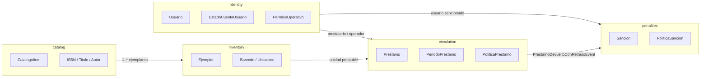
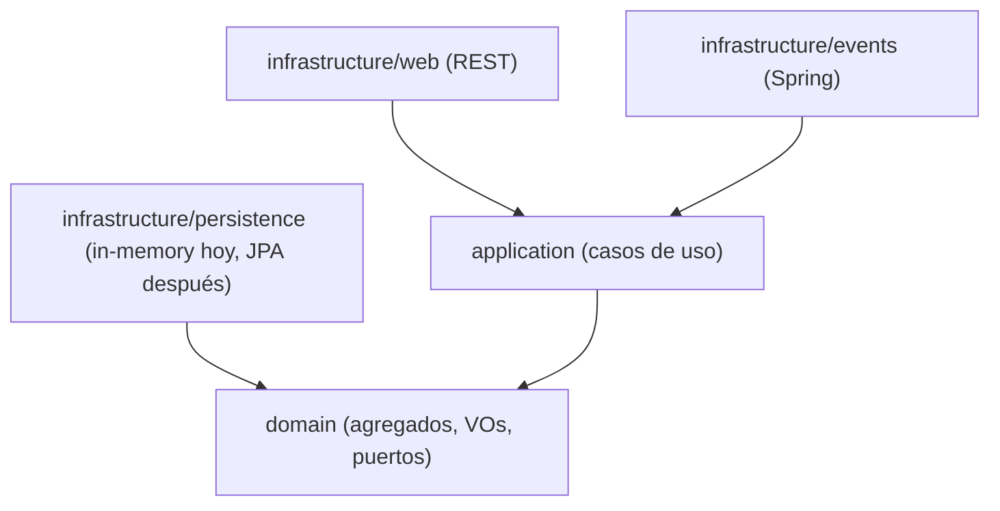
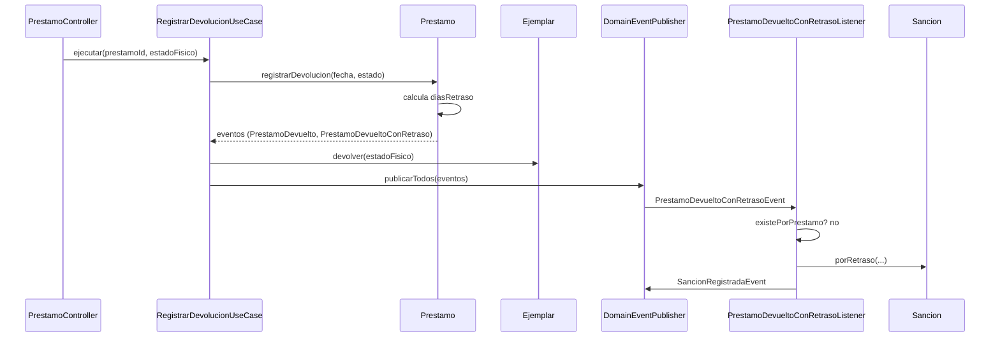

# Arquitectura

Documento de referencia del corte 1. Explica cómo se divide el sistema, qué depende de qué
y por qué. Las decisiones puntuales están en [`adr/`](adr/).

---

## 1. Principios

1. **El dominio manda.** Las reglas viven en agregados y políticas; los casos de uso solo
   orquestan. Un controlador no decide si un préstamo es válido.
2. **Dominio sin framework.** `com.biblioteca.*.domain` no importa Spring, JPA, Hibernate,
   Jackson ni clases de `infrastructure`. ArchUnit lo verifica en cada build.
3. **Dependencias hacia adentro.** Infraestructura conoce aplicación y dominio; aplicación
   conoce dominio; dominio no conoce a nadie.
4. **Puertos en el dominio.** Los repositorios son interfaces del dominio
   (`domain/repository/`), no de infraestructura.
5. **Una sola fuente de verdad para disponibilidad.** No hay contadores de stock en el
   catálogo. El estado del `Ejemplar` y el préstamo activo determinan si se puede prestar.
6. **Eventos para desacoplar contextos.** `circulation` no importa `penalties`; publica un
   evento y `penalties` reacciona.

---

## 2. Mapa de contextos



Los contextos comparten solo identificadores tipados y eventos. No comparten agregados ni
repositorios de escritura.

---

## 3. Regla de dependencias



`domain` no apunta a ninguna capa superior: las flechas solo entran.

Reglas ejecutables en `ArquitecturaTest`:

- `..domain..` no depende de Spring, Jakarta Persistence, Hibernate, Jackson ni
  `..infrastructure..`.
- `..domain.repository..` contiene solo interfaces.
- `..application..` no depende de `..infrastructure..`.

---

## 4. Shared kernel

Paquete `com.biblioteca.shared`:

| Elemento | Rol |
|---|---|
| `AggregateRoot<ID>` | Identidad, lista de eventos y `extraerEventos()` |
| `ValueObject` | Marcador para objetos inmutables |
| `DomainEvent` | Contrato de evento (`eventId`, `ocurridoEn`) |
| `DomainException` | Error de dominio con `codigo` estable |
| `BusinessRuleException` | Regla de negocio violada (HTTP 409) |
| `NotFoundException` | Recurso inexistente (HTTP 404) |
| `DomainEventPublisher` | Puerto de salida para publicar eventos |

No hay utilidades genéricas innecesarias ni un “service” global. Cada contexto tiene su
propio modelo.

---

## 5. Contextos

### 5.1 `catalog`

**Agregado:** `CatalogoItem`

- Identidad: `CatalogoItemId` (UUID).
- Atributos: `Titulo`, `TipoItem`, `DetalleItem`, `activo`, `fechaAlta`.
- `DetalleItem` es una interfaz sellada con tres implementaciones:
  - `LibroDetalle(ISBN, Autor, editorial, anioPublicacion)`
  - `EquipoDetalle(marca, modelo)`
  - `OtroDetalle(descripcion)`
- Value objects: `ISBN` (valida checksum ISBN-10/13 y normaliza), `Titulo`, `Autor`.

**Decisión clave:** no existe `stockTotal`, `stockDisponible` ni contadores equivalentes.
Un ítem de catálogo es la *obra*; los ejemplares físicos viven en `inventory`. La
disponibilidad se calcula con `Ejemplar.estaDisponible()` y la ausencia de un préstamo
activo.

**Puerto:** `CatalogoItemRepository` (`guardar`, `buscarPorId`, `listarTodos`,
`existePorIsbn`).

**Casos de uso:** registrar libro/equipo/otro, listar, obtener, desactivar.

---

### 5.2 `inventory`

**Agregado:** `Ejemplar`

- Identidad: `EjemplarId` (UUID).
- Atributos: `catalogoItemId`, `Barcode`, `Ubicacion`, `EstadoFisico`, `notas`, `fechaAlta`.
- `Barcode` normaliza a mayúsculas y valida el formato.
- `EstadoFisico`: `DISPONIBLE`, `PRESTADO`, `DANADO`, `PERDIDO`, `BAJA`.
- Transiciones: prestar (`DISPONIBLE → PRESTADO`), devolver (`PRESTADO → DISPONIBLE |
  DANADO | PERDIDO`), dar de baja (solo si no está prestado).

**Puerto:** `EjemplarRepository` (`guardar`, `buscarPorId`, `buscarPorBarcode`,
`listarTodos`, `listarPorItem`, `existePorBarcode`).

**Casos de uso:** registrar ejemplar, listar, obtener por ID o barcode, dar de baja.

---

### 5.3 `identity`

**Agregado:** `Usuario`

- Identidad: `UsuarioId` (UUID).
- Atributos: `EmailAddress`, `NombreCompleto`, `PerfilPrestatario`, `EstadoCuentaUsuario`,
  `permisos`, `fechaAlta`, `fechaValidacion`, `motivoSuspension`.
- `PerfilPrestatario`: `ALUMNO`, `DOCENTE`, `ADMINISTRATIVO`.
- `EstadoCuentaUsuario`: `PROVISIONAL`, `VALIDADO`, `SUSPENDIDO`.

**Máquina de estados:**

```text
PROVISIONAL --validar--> VALIDADO --suspender--> SUSPENDIDO
                               ^                     |
                               +------reactivar------+
```

Invariantes:

- `PROVISIONAL` no tiene `fechaValidacion`.
- `VALIDADO` exige `fechaValidacion`.
- `SUSPENDIDO` exige `fechaValidacion` y `motivoSuspension`.
- Solo `VALIDADO` recibe permisos operativos.
- `puedeConsultarCatalogo()` siempre es `true`; `puedeSolicitarPrestamo()` y
  `puedeOperarVentanilla()` exigen `VALIDADO` (el segundo además el permiso
  `REGISTRAR_PRESTAMO`).

**Permisos:** `REGISTRAR_PRESTAMO`, `VALIDAR_USUARIO_PROVISIONAL`, `GESTIONAR_CATALOGO`,
`GESTIONAR_SANCIONES`. No son roles; se otorgan explícitamente.

**Puerto:** `UsuarioRepository` (`guardar`, `buscarPorId`, `buscarPorEmail`,
`listarTodos`, `existePorEmail`).

**Casos de uso:** registrar provisional, validar, suspender, reactivar, otorgar/revocar
permiso, listar, obtener.

---

### 5.4 `circulation`

**Agregado:** `Prestamo`

- Identidad: `PrestamoId` (UUID).
- Referencias: `operadorId`, `prestatarioId`, `ejemplarId`.
- Atributos: `PeriodoPrestamo`, `LugarUso`, `EstadoPrestamo`, `fechaDevolucion`,
  `renovaciones`, `observaciones`, `fechaAlta`.
- `EstadoPrestamo`: `ACTIVO`, `DEVUELTO`, `PERDIDO`. **“Vencido” no se persiste**: se
  deriva de `PeriodoPrestamo.estaVencido(hoy)`.
- Invariante central: `operadorId != prestatarioId`.

**Políticas:** `PoliticaPrestamo` (interfaz) y `PoliticaPrestamoEstandar` (implementación
sin Spring). Determinan días de préstamo, domicilio, máximo de préstamos y renovaciones
según perfil y tipo de ítem.

**Puerto:** `PrestamoRepository` (`guardar`, `buscarPorId`, `listarTodos`,
`listarPorPrestatario`, `existeActivoPara`, `contarActivosPor`, `tieneVencido`).

**Casos de uso:** registrar préstamo, devolución, renovación, listar, obtener.

**Validaciones del caso de uso `RegistrarPrestamoUseCase` (en orden):**

1. El prestatario existe y está validado.
2. El operador existe, está validado y tiene `REGISTRAR_PRESTAMO`.
3. No hay autopréstamo.
4. El ítem está activo.
5. El ejemplar está disponible.
6. No hay otro préstamo activo sobre ese ejemplar.
7. El prestatario no tiene sanción activa.
8. El prestatario no tiene préstamo vencido pendiente.
9. No supera el máximo de préstamos simultáneos.
10. La política permite el lugar de uso (domicilio para equipos).
11. Calcula el período y registra el préstamo + eventos.

---

### 5.5 `penalties`

**Agregado:** `Sancion`

- Identidad: `SancionId` (UUID).
- Referencias: `usuarioId`, `prestamoId` (opcional en sanciones manuales).
- Atributos: `MotivoSancion`, `diasSuspension`, `MontoMulta`, `fechaInicio`, `fechaFin`,
  `EstadoSancion`, `observaciones`.
- `MotivoSancion`: `RETRASO`, `DANO`, `PERDIDA`.
- `EstadoSancion`: `ACTIVA`, `CUMPLIDA`, `ANULADA`.

**Vigencia:** una sanción está vigente desde `fechaInicio` (inclusive) hasta `fechaFin`
(exclusiva). Una suspensión de 1 día iniciada hoy bloquea hoy y deja de bloquear mañana.

**Política:** `PoliticaSancionEstandar`: 1 día de suspensión y S/ 1.00 por día de retraso,
con tope de 30 días.

**Puerto:** `SancionRepository` (`guardar`, `buscarPorId`, `listarTodas`,
`listarPorUsuario`, `existeActivaPara`, `existePorPrestamo`).

**Casos de uso:** listar, cumplir, registrar sanción manual.

**Listener:** `PrestamoDevueltoConRetrasoListener` escucha
`PrestamoDevueltoConRetrasoEvent`, verifica idempotencia por `prestamoId` y crea la sanción.

---

## 6. Flujo de eventos

### Devolución tardía



Hoy la entrega es síncrona, en el mismo hilo y transacción lógica. El puerto permite
cambiar a `@TransactionalEventListener` + outbox o a un broker sin tocar el dominio.
La idempotencia se apoya en `SancionRepository.existePorPrestamo`.

### Eventos publicados

| Contexto | Evento | Cuándo |
|---|---|---|
| `catalog` | `ItemCatalogoRegistradoEvent` | Al registrar un ítem |
| `inventory` | `EjemplarRegistradoEvent` | Al registrar un ejemplar |
| `inventory` | `EjemplarPrestadoEvent` | Al prestar |
| `inventory` | `EjemplarDevueltoEvent` | Al devolver |
| `identity` | `UsuarioProvisionalRegistradoEvent` | Al registrarse |
| `identity` | `UsuarioValidadoEvent` | Al validar |
| `identity` | `UsuarioSuspendidoEvent` | Al suspender |
| `identity` | `UsuarioReactivadoEvent` | Al reactivar |
| `identity` | `PermisoOtorgadoEvent` | Al otorgar permiso |
| `circulation` | `PrestamoRegistradoEvent` | Al crear préstamo |
| `circulation` | `PrestamoRenovadoEvent` | Al renovar |
| `circulation` | `PrestamoDevueltoEvent` | Al devolver |
| `circulation` | `PrestamoDevueltoConRetrasoEvent` | Si la devolución es tardía |
| `penalties` | `SancionRegistradaEvent` | Al crear sanción |
| `penalties` | `SancionCumplidaEvent` | Al cumplir |

---

## 7. Persistencia (fase 2)

El corte 1 usa adaptadores in-memory en
`infrastructure/persistence/inmemory/`. Todos implementan los puertos del dominio.

Plan para JPA:

- Una entidad JPA por agregado, no por tabla de dominio.
- Mapear value objects como `@Embeddable` o columnas tipadas.
- `Prestamo` guarda `estado` y fechas; “vencido” sigue siendo derivado.
- `Ejemplar` tiene `barcode` único y `catalogoItemId` indexado.
- `Prestamo` requiere un índice único parcial para “un préstamo ACTIVO por ejemplar”.
- `Sancion` requiere índice por `(usuarioId, estado, fechaInicio, fechaFin)`.
- Migraciones con Flyway; seeds de demo solo en perfil `demo`.
- Tests de integración con Testcontainers.
- Outbox para eventos: tabla `domain_event` y un publicador posterior.

El `docker-compose.yml` de la raíz ya define PostgreSQL 16 y Adminer para esa fase.

---

## 8. Estrategia de pruebas

| Nivel | Qué prueba | Dónde |
|---|---|---|
| Value objects | Normalización y validación | `catalog/domain/vo/ISBNTest` |
| Agregados | Invariantes y transiciones | `identity`, `inventory`, `circulation`, `penalties` |
| Aplicación | Orquestación y reglas compuestas | `*UseCaseTest` |
| Flujo | Préstamo → devolución tardía → sanción → bloqueo | `FlujoPrestamoTest` |
| Contexto | Beans y wiring de Spring | `ContextLoadsTest` |
| Arquitectura | Dependencias y pureza | `ArquitecturaTest` |

Las pruebas de aplicación usan dobles in-memory reales (los mismos adaptadores), no mocks
frágiles de repositorios. El foco está en el comportamiento observable.

---

## 9. Correcciones respecto al legacy

| Problema legacy | Corrección |
|---|---|
| `Application` con nombre distinto al declarado | `BibliotecaApplication` coherente |
| Imports a `pe.edu.unsa.sisprestamos` inexistentes | Paquete único `com.biblioteca` |
| UUID en Java vs `BIGINT` en SQL | IDs UUID tipados en todo el sistema |
| `stockTotal` y `stockDisponible` duplicados | Sin contadores; disponibilidad derivada del ejemplar |
| Repositorio con `@EntityScan` roto | Adaptadores in-memory explícitos, puertos en dominio |
| Seeds contradictorios | `DemoDataConfig` con IDs fijos y un caso vencido reproducible |
| Sin restricción de préstamo activo único | Regla en caso de uso + índice único parcial planificado |
| `target/` versionado | `.gitignore` y build limpio |
| Sin tests ni documentación | 57 tests, ADRs y demo reproducible |

---

## 10. Riesgos y trade-offs

- **In-memory:** no prueba concurrencia real ni transacciones. Es un riesgo aceptado para
  el corte 1; se mitiga con la fase 2.
- **Eventos síncronos:** si el listener falla, la devolución podría fallar. En la fase 2 se
  separa con outbox y reintentos.
- **Sin auth:** cualquiera puede enviar un `operadorId` válido. La fase 3 introduce JWT y
  deriva el operador del token, no del body.
- **Políticas en código:** los plazos y multas son clases Java. Se pueden externalizar a
  configuración cuando el negocio lo requiera.
- **Catálogo sin control de permisos:** pendiente de cerrar en la fase 2/3.
